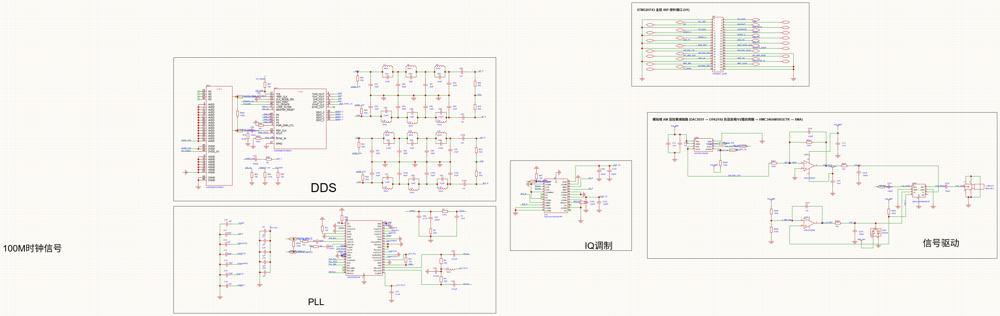
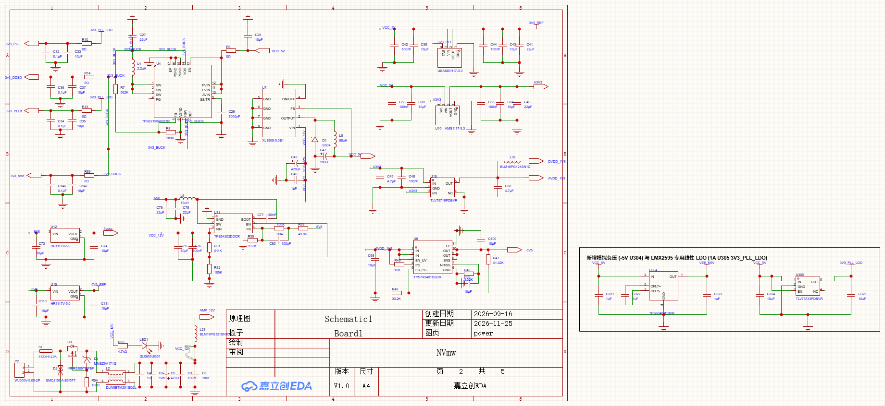
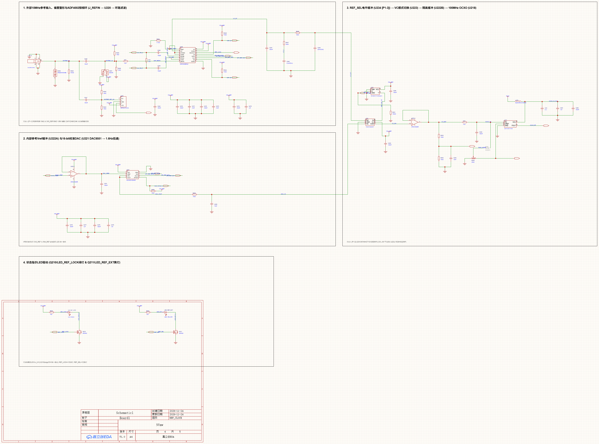
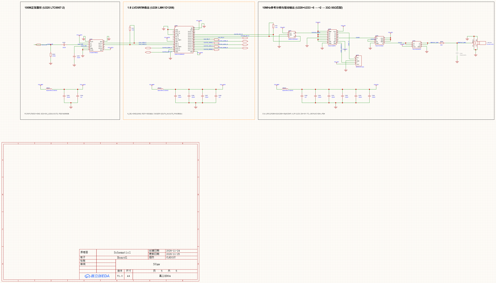
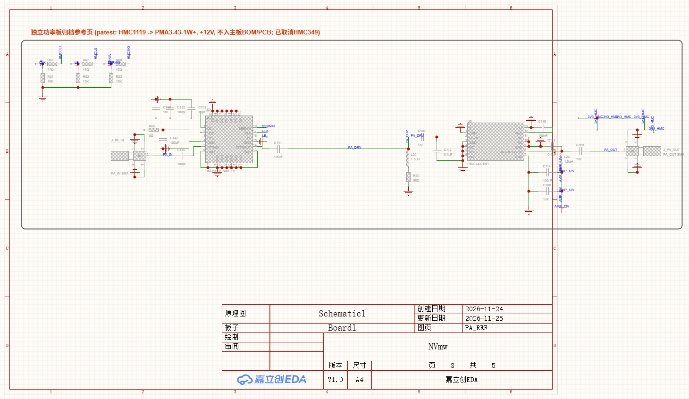
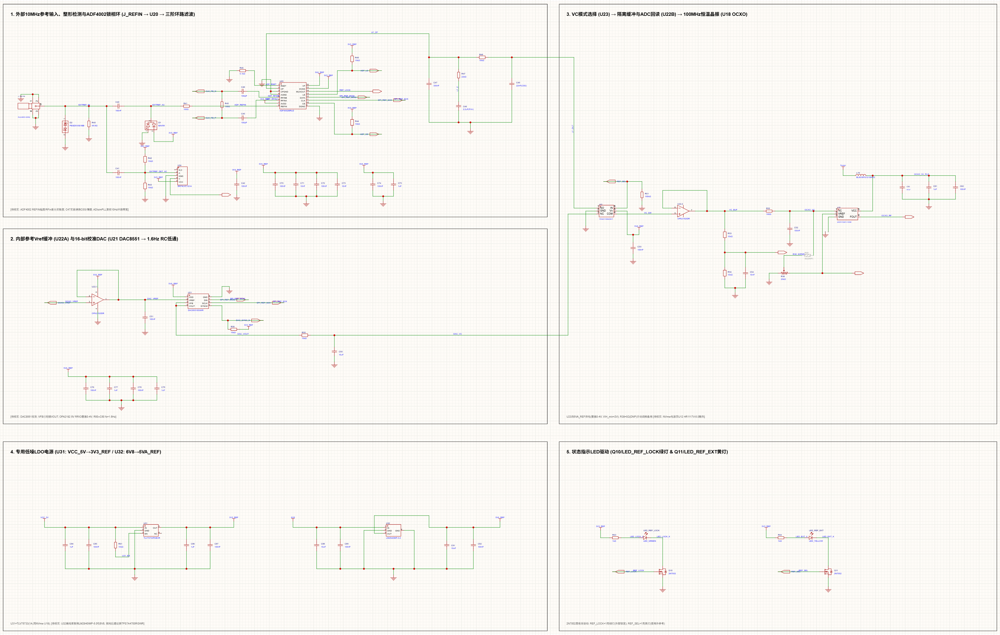
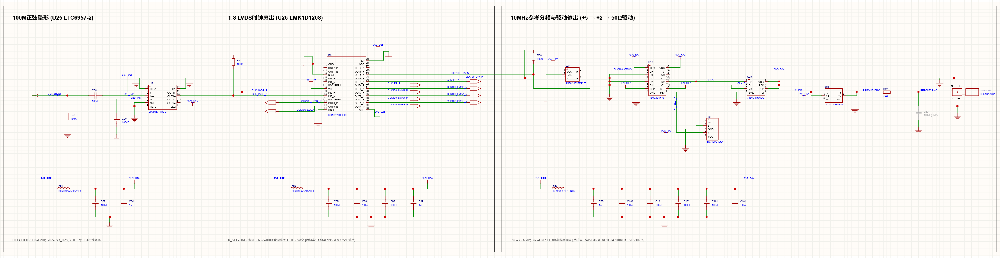

# micro_contral · NV 色心实验用微波源与参考时钟子系统

本仓库归档 NV 色心实验用微波源整机（`NVmw` 单通道 v1）与参考时钟子系统（`clktree`）的实机原理图、电气与规范校验报告、需求规格文档、自动化重建/验证脚本以及完整的 AI 辅助设计与审查对话记录。

---

## 目录结构

```text
micro_contral/
├── README.md                                       # 本文件（项目总览、核心成果与 5 页原理图直览）
├── docs/
│   ├── nvmw_v1_review_and_refactor_report.md       # NVmw 整机审查、模拟 AM 升级与单通道 v1 重构完成报告（§一–§十）
│   ├── clktree_audit_report.md                     # clktree 原理图重建与网表逐条对账报告
│   ├── schematic_conventions.md                    # 沉淀的嘉立创 EDA 模块化布线与防重叠规范
│   ├── conversations/                              # 相关硬件设计、审查与调研对话记录
│   │   ├── 01_clktree_schematic_and_wiring_rules.md
│   │   ├── 02_nvmw_architecture_and_pcb_review.md  # （已更新至 2026-11-25 实机重构与验证完成）
│   │   ├── 03_microwave_source_research_status_and_specs.md
│   │   └── 04_patest_board_bringup.md
│   └── requirements/
│       ├── _原始需求_微波源设计要求1009.docx         # 微波源原始需求文档
│       └── 参考时钟_选型与连接规格_v1.md              # 参考时钟子系统选型与连接规格书 v1
├── hardware/
│   ├── schematics/
│   │   ├── nvmw_v1/                                # NVmw 单通道 v1 五页实机最新高清原理图 PNG
│   │   │   ├── NVmw_sign.png                       # signal 主链 + 模拟域 AM VVA + H1 主控接口
│   │   │   ├── NVmw_power.png                      # 全局电源树 + U304(-5V) + U305(1A 3V3_PLL_LDO)
│   │   │   ├── NVmw_REF_CLOCK.png                  # +200 位号 100 MHz 双模参考与 OCXO 页
│   │   │   ├── NVmw_CLKDIST.png                    # +200 位号整形、1:8 LVDS 扇出与 10 MHz 分频输出页
│   │   │   └── NVmw_PA_REF.png                     # 独立功率板架构归档参考页（不进主板 BOM/PCB）
│   │   ├── REF_CLOCK_v2.png                        # clktree 独立子工程阶段原理图 v2
│   │   └── CLK_DIST_v2.png                         # clktree 独立子工程阶段原理图 v2
│   ├── verification/
│   │   └── nvmw_v1_verify_report.json              # step_e_verify.py 全工程 5 页只读门禁验证快照
│   ├── netlist/
│   │   └── clktree_netlist.txt                     # 导出的 Protel 2.0 完整网表（66 网 / 101 器件）
│   └── easyeda/
│       └── README.md                               # 嘉立创 EDA .epro 工程源文件归档说明
└── scripts/
    ├── nvmw_v1/                                    # NVmw 单通道 v1 实机重建与只读全页校验脚本集
    │   ├── nvmw_lib.py
    │   ├── step_b_power.py
    │   ├── step_b_polish.py
    │   ├── step_c_sign.py
    │   ├── step_c_v2.py
    │   ├── step_d_ref_clock.py
    │   ├── step_d_clk_dist.py
    │   └── step_e_verify.py
    └── netlist_verifier.py                         # clktree Protel 2.0 网表自动化核验脚本
```

---

## `NVmw` 单通道 v1 整机原理图重构核心成果（5 页）

- **架构演进**：确定“**单通道 v1 先行** + **取消末级开关 `U17 (HMC349)`** + **AM 调制移至射频模拟域**（主板 `U302 DAC8551 → U303A/B OPA2192 → U301 HMC346AMS8GETR → J_RFOUT`）+ **时钟树 `REF_CLOCK`/`CLKDIST` 并入整机并施加 `+200` 全局位号**”。
- **电气与规范门禁（100% PASS）**：通过只读并查集全网校验脚本 [scripts/nvmw_v1/step_e_verify.py](./scripts/nvmw_v1/step_e_verify.py) 实测验证（严禁调用 `getNetlist` 触发重编位号），全工程 5 页共 **345 个组件实例**（其中 `PA_REF` 归档页 27 颗均 `AddIntoBom=false, AddIntoPcb=false`）：
  - **零短路 / 零悬空 / 零真实离格**：全工程 `0` 短路、新增及迁移区 `0` 非 NC 悬空引脚、`0` 真实离格连接、全局 `0` 位号冲突（仅 `U5 / U303 / U222` 为双单元复用）；
  - **三项布线规范 100% 达标**：`Power/Ground rot ≠ 0` 为 `0`、电源/地导线冗余文字标签为 `0`、模块内孤岛贴端口为 `0`（含 `U304-C322` 正交飞跨直连与 `H1`/`U226` 奇偶错位水平引出）；
  - **关键电源与时钟闭环**：`U305 (TLV75733P 1A)` 专属线性 LDO 通过 `R10/R13` 独立供电 `3V3_PLL` / `3v3_PLLrf` 并彻底隔离于 `U4 (3V3_BUCK)`；`U5.1 (SYNC_IN)` 已解除禁用并接地 `R309 (10kΩ)`；合入 `[P0-1]`~`[P2-1]`、`C299..C304` 接地及 `LED_REF_LOCK/EXT` 极性校准；已修复 `sign` 页 28 处及 `power` 页 13 处新增/替换器件 `BOM/PCB` 属性。
- **详细审查与重构报告**：见 [docs/nvmw_v1_review_and_refactor_report.md](./docs/nvmw_v1_review_and_refactor_report.md)（§一–§十）与验证数据 [hardware/verification/nvmw_v1_verify_report.json](./hardware/verification/nvmw_v1_verify_report.json)。

### 1. `sign` 页（DDS + PLL + IQ 调制 + 模拟域 AM VVA + STM32H7 `H1` 主控接口）



### 2. `power` 页（全局电源树 + `U304 TPS60403 -5V` + `U305 TLV75733P 1A LDO`）



### 3. `REF_CLOCK` 页（外参考鉴相与偏置 + DAC 校准 + `REF_SEL` 5V 缓冲 + `100 MHz OCXO`）



### 4. `CLKDIST` 页（`LTC6957-2` 正弦整形 + `LMK1D1208` `1:8` LVDS 扇出 + `10 MHz ÷10` 参考输出）



### 5. `PA_REF` 页（独立功率板架构归档页：`BOM=false, PCB=false`）



---

## `clktree` 参考时钟独立子工程基线成果

- **规模与校验**：共 **101 个位号**、**66 条命名网络**（0 条 `$...` 自动匿名网络）、**303 / 320 引脚连通**（其余 17 脚均为官方手册确认的 NC/未用脚），规格 §6 全部 **49 / 49** 信号与电源网络精确匹配。
- **详细核验与待确认项**：见 [docs/clktree_audit_report.md](./docs/clktree_audit_report.md)。

### 1. `REF_CLOCK` 页（v2 基线）



### 2. `CLK_DIST` 页（v2 基线）



---

## 关联文档

- 📋 [NVmw 整机审查、模拟 AM 升级与单通道 v1 重构报告](./docs/nvmw_v1_review_and_refactor_report.md)
- 📊 [NVmw 单通道 v1 全页只读门禁校验数据 (JSON)](./hardware/verification/nvmw_v1_verify_report.json)
- 📋 [clktree 原理图与网表完整对账报告](./docs/clktree_audit_report.md)
- 📐 [嘉立创 EDA 原理图模块化布线与防重叠规范](./docs/schematic_conventions.md)
- 📄 [参考时钟选型与连接规格 v1](./docs/requirements/参考时钟_选型与连接规格_v1.md)
- 💬 **对话记录归档**：
  - [01 · 参考时钟子系统（clktree）原理图重建与布线规范](./docs/conversations/01_clktree_schematic_and_wiring_rules.md)
  - [02 · NV 微波源整机架构、原理图与 PCB 审查（更新至 v1 实机重构完成）](./docs/conversations/02_nvmw_architecture_and_pcb_review.md)
  - [03 · 微波源国内外研究现状与核心指标提取](./docs/conversations/03_microwave_source_research_status_and_specs.md)
  - [04 · 功放测试板（patest）首版上电记录](./docs/conversations/04_patest_board_bringup.md)
