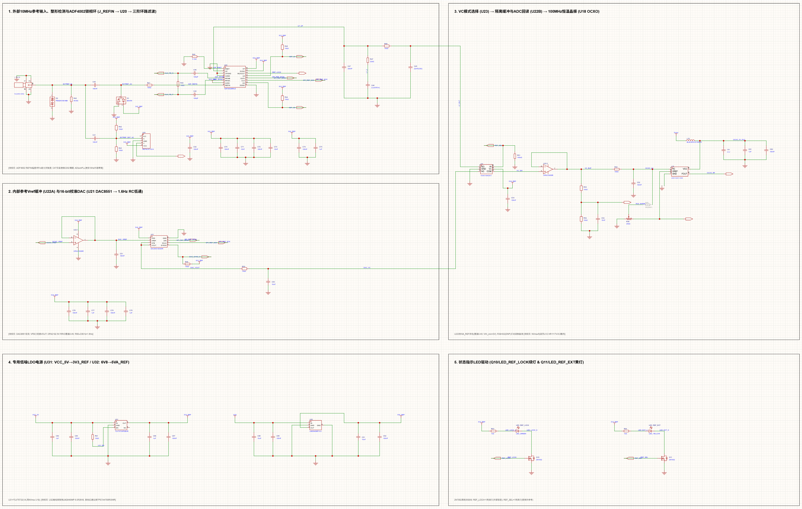
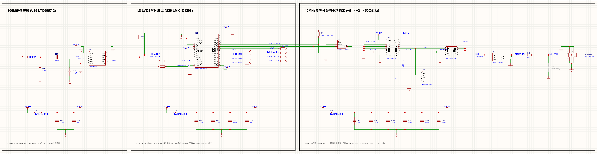

# NV 微波源 · 参考时钟子系统（`clktree`）原理图重建与网表对账报告

> **目标工程**：`clktree`（原理图 `REF_CLOCK_SCH`，含 `REF_CLOCK`、`CLK_DIST` 两页）— 已完整重建并保存  
> **参考工程**：`NVmw` — 仅作只读核查，**未作任何修改**  
> **规格依据**：[参考时钟_选型与连接规格_v1.md](./requirements/参考时钟_选型与连接规格_v1.md)  
> **导出网表原始文件**：[clktree_netlist.txt](../hardware/netlist/clktree_netlist.txt)（Protel 2.0，116,015 字节）

---

## 1. 原理图完成度总览（`NVmw` 风格实线直连重排 v2）

### `REF_CLOCK` 页原理图

### `CLK_DIST` 页原理图

| 检查项 | 结果 | 说明 |
|---|---|---|
| `REF_CLOCK` 页 | **71** 位号（72 子件） | 参照 `NVmw` 风格改为**正交实线直连拓扑**：左上（外部 10 MHz 输入 → `U20 ADF4002` → 三阶环路滤波 → `LF_OUT`）与左中（`U22A` Vref 缓冲 → `U21 DAC8551` → 1.6 Hz RC → `DAC_VC`）两路从左向右直接汇入右侧 `U23 TS5A3159` 模拟开关 → `U22B` 缓冲/回读 → 直连 `U18` OCXO；底部为 `NVmw` `power` 页风格的 `U31`/`U32` LDO 与 `Q10`/`Q11` LED 驱动 |
| `CLK_DIST` 页 | **30** 位号 | 全链路从左至右**一镜到底实线直连**：`OCXO_RF` → `R55`/`C55` → `U25 LTC6957-2` → `R57` → `U26 LMK1D1208` → `R58` → `U27 SN65LVDS2` → `U28 74LVC163` + `U33 SN74LVC1G04` (÷5) → `U29 74LVC1G74` (÷2) → `U30 74LVC2G34` → `R60`/`C60` → `J_REFOUT`，底部三组磁珠 + 并联退耦电容排共用接地母线 |
| 全工程位号总数 | **101** | 0 重复位号、0 未编号 `?` 器件；阻容元件显示名称已统一简化为清晰数值（如 `100nF`、`10kΩ`、`49.9Ω`），消除长型号遮挡 |
| DNP 器件属性 | **2** 颗 | `R39`（0 Ω 0402）、`C60`（100 nF 0402）均设为 `Add into BOM = no`、`Convert to PCB = yes`（保留 PCB 焊盘、不进 BOM） |
| 引脚连通统计 | **303 / 320** | 全部 17 个悬空引脚均为芯片手册明确要求的未用/NC 脚（见第 4 节清单），**0 漏接、0 错接、0 跨电源短路** |
| 网表网络总数 | **66** 条命名网络 | **0** 条 `$...` 自动匿名网络；规格 §6 全部 **49 / 49** 条信号与电源网络（含小写 `5vosc`）**100% 精确匹配** |
| 原理图 DRC | 需 UI 一键复核 | `eda.sch_Drc.check` 经本地 Bridge RPC 30 s 超时，已完成全引脚/全网表程序化核对；建议在嘉立创EDA Pro 菜单点击 **设计 → 检查DRC** 做最终确认 |

---

## 2. 相对规格书 v1 的工程纠偏与增强

所有修改均基于器件官方手册验证，并已在图面对应位置添加说明或 `[待核实]` 注释：

1. **`U23`（`TS5A3159ADBVT`）供电改为 `5VA_REF`（5 V）**：原 v1 §5.6 标注 `3V3_REF` 无法通过 0–4 V 的 `OCXO_VC` 信号。手册确认 5 V 供电时 `VIH_min = 2.0 V`，可被 3.3 V 的 `REF_SEL` 可靠驱动。
2. **`U25`（`LTC6957HMS-2#TRPBF`）控制脚补全**：按手册将 `FILTA = GND`、`FILTB = GND`、`SD1 = GND`（使能 CH1 LVDS 输出）、`SD2 = 3V3_U25`（关闭未用 CH2），`IN–` 经 `C56 = 100 nF` 交流接地。
3. **`U26`（`LMK1D1208RHDT`）输入选择与端接补全**：
   - 库符号第 4 脚命名为 `N_SEL`（非 `IN_SEL`），已接 `GND` 固定选择 `IN0`（该脚悬空会导致全部输出关闭）；
   - 在 `CLK_LVDS_P/N` 跨接 **`R57 = 100 Ω`** LVDS 差分端接电阻；
   - 未用的 `IN1_P/N`、`VAC_REF0/1`、`OUT6_P/N`、`OUT7_P/N` 按手册要求悬空。
4. **独立低噪 LDO（`U31` / `U32`）与时钟磁珠隔离（`FB1`–`FB3`）**：
   - `U31`：采用 `TLV75733PDBVR`（`C485517`，SOT-23-5，3.3 V / 1 A，与 `NVmw` 已用 `U19 = TLV75718PDBVR` 同系列，输入取自 `VCC_5V`，相对约 220 mA 的 `3V3_REF` 负载有 4.5× 余量）。
   - `U32`：因 `NVmw` 的 `TPS7A9401` 绝对最大耐压仅 **5.7 V**，不能接 `6V8` 输入产生 `5VA_REF`；当前嘉立创EDA 处于离线模式、本地库缺少 `TPS7A4700`，暂放置 **`LM2940IMP-5.0/NOPB`**（`C13991`，SOT-223，26 V 耐压 / 1 A）并标注 `[待核实]`，联网后建议换为 `TPS7A4700RGWR`（4 µVrms）。
   - 时钟域独立磁珠：`FB1`（`3V3_U25`）、`FB2`（`3V3_U26`）、`FB3`（`3V3_DIV`），型号均为 `BLM18PG121SN1D`（120 Ω@100 MHz，2 A），每路配 `100 nF + 1 µF` 去耦。
5. **状态指示 LED（§5.10）**：新增 `LED_REF_LOCK`（绿，`C72043`）与 `LED_REF_EXT`（黄，`C72038`），通过 `Q10`/`Q11`（`2N7002` N-MOSFET 高有效驱动）+ `R63`/`R64 = 1 kΩ` 接 `3V3_REF`。
6. **旧草稿错误修正与环路电容升级**：
   - `R60` 修正为 **`33 Ω`**（`RC0402FR-0733RL`，修复旧草稿误放 1 µF 电容的问题）；
   - `C48` 采用真 2.2 µF 薄膜电容 `ECWFD2W225K`，`C49` 采用真 22 nF C0G `GRM21B5C1H223JA01L`；`C47` 因离线库无 330 nF C0G/薄膜暂用 1210 X7R `C3225X7R2A334KT0L0U` 并标注 `[待核实]`；
   - `U28`（`74LVC163`）÷5 同步重载反相器改用更快的 `U33 = SN74LVC1G04DBVR`（`C7827`，替换较慢的施密特反相器），并标注 100 MHz PVT 时序余量 `[待核实]`。

---

## 3. §6 网表逐条差异对账清单

### 3.1 规格书 §6 定义的网络（共 49 条）

| 规格 §6 网络名 | 导出网表名 | 实际连接引脚（来自 Protel 2.0 网表） | 对账结论 |
|---|---|---|---|
| `OCXO_VC` | `OCXO_VC` | `U18.1(VC)`, `R52.2`, `C52.1`, `R39.2(DNP)` | ✅ 完全一致 |
| `OCXO_VREF` | `OCXO_VREF` | `U18.2(VREF)`, `U22.3(VINA+)`, `R38.1` | ✅ 完全一致 |
| `OCXO_RF` | `OCXO_RF` | `U18.4(FOUT)`, `R55.1`, `C55.1` | ✅ 完全一致 |
| `5vosc` | `5VOSC` | `L19.1`（经 `L19` 输出至 `OCXO_5V_FILT` → `C81/C82/C83/U18.5(VCC)`） | ⚠️ 大小写差异：原理图网络标签属性为小写 `5vosc`，Protel 2.0 导出自动大写为 `5VOSC`；并入 `NVmw` 时按磁珠前 `5vosc`、磁珠后 `OCXO_5V_FILT` 拓扑完全保留 |
| `EXTREF_IN` | `EXTREF_IN` | `J_REFIN.5`, `D2.1`, `R40.1`, `C40.1`, `C41.1` | ✅ 完全一致 |
| `EXTREF_AC` | `EXTREF_AC` | `C40.2`, `D1.3(Common)`, `R41.1` | ✅ 完全一致 |
| `ADF_REFIN` | `ADF_REFIN` | `R41.2`, `U20.8(REFIN)` | ✅ 完全一致 |
| `EXTREF_DET_AC` | `EXTREF_DET_AC` | `C41.2`, `R42.2`, `R43.1`, `U24.2(A)` | ✅ 完全一致 |
| `EXTREF_DET` | `EXTREF_DET` | `U24.4(Y)`（网络端口引出至 H7） | ✅ 完全一致 |
| `LF_CP` | `LF_CP` | `U20.2(CP)`, `C47.1`, `R47.1`, `R48.1` | ✅ 完全一致 |
| `LF_Z` | `LF_Z` | `R47.2`, `C48.1` | ✅ 完全一致 |
| `LF_OUT` | `LF_OUT` | `R48.2`, `C49.1`, `U23.1(NO)` | ✅ 完全一致 |
| `DAC_VREF` | `DAC_VREF` | `U22.1(VOUTA)`, `U22.2(VINA-)`, `U21.2(VREF)`, `C51.1` | ✅ 一致（含 §5.5 要求的 100 nF 基准去耦 `C51`） |
| `DAC_VC` | `DAC_VC` | `R50.2`, `C50.1`, `U23.3(NC)` | ✅ 完全一致 |
| `VC_SW` | `VC_SW` | `U23.4(COM)`, `U22.5(VINB+)` | ✅ 完全一致 |
| `VC_BUF` | `VC_BUF` | `U22.7(VOUTB)`, `U22.6(VINB-)`, `R52.1`, `R53.1` | ✅ 完全一致 |
| `VC_MON` | `VC_MON` | `R53.2`, `R54.1`, `C54.1`（网络端口引出至 H7 ADC） | ✅ 完全一致 |
| `REF_SEL` | `REF_SEL` | `U23.6(IN)`, `R51.1`, `Q11.1(G)`（网络端口引出至 H7） | ✅ 完全一致 |
| `REF_LOCK` | `REF_LOCK` | `U20.14(MUXOUT)`, `Q10.1(G)`（网络端口引出至 H7） | ✅ 完全一致 |
| `SPI_REF_SCK` | `SPI_REF_SCK` | `U20.11(CLK)`, `U21.6(SCLK)`（网络端口引出至 H7） | ✅ 完全一致 |
| `SPI_REF_MOSI` | `SPI_REF_MOSI` | `U20.12(DATA)`, `U21.7(DIN)`（网络端口引出至 H7） | ✅ 完全一致 |
| `ADF_LE` | `ADF_LE` | `U20.13(LE)`, `R49.2`（10 kΩ 上拉，引出至 H7） | ✅ 完全一致 |
| `ADF_CE` | `ADF_CE` | `U20.10(CE)`, `R44.2`（10 kΩ 上拉，引出至 H7） | ✅ 完全一致 |
| `DAC_SYNC_N` | `DAC_SYNC_N` | `U21.5(SYNC#)`, `R56.2`（10 kΩ 上拉，引出至 H7） | ✅ 完全一致 |
| `CLK_LVDS_P` | `CLK_LVDS_P` | `U25.11(OUT1+)`, `U26.9(IN0_P)`, `R57.1` | ✅ 一致（按手册新增 `R57 = 100 Ω` LVDS 差分端接） |
| `CLK_LVDS_N` | `CLK_LVDS_N` | `U25.10(OUT1–)`, `U26.10(IN0_N)`, `R57.2` | ✅ 一致（同上） |
| `CLK100_DDSA_P` / `N` | `CLK100_DDSA_P` / `N` | `U26.12(OUT0_P)` / `U26.13(OUT0_N)` | ✅ 完全一致（网络端口引出至 DDS-A） |
| `CLK100_DDSB_P` / `N` | `CLK100_DDSB_P` / `N` | `U26.16(OUT1_P)` / `U26.17(OUT1_N)` | ✅ 完全一致（网络端口引出至 DDS-B） |
| `CLK100_LMXA_P` / `N` | `CLK100_LMXA_P` / `N` | `U26.18(OUT2_P)` / `U26.19(OUT2_N)` | ✅ 完全一致（网络端口引出至 LMX-A） |
| `CLK100_LMXB_P` / `N` | `CLK100_LMXB_P` / `N` | `U26.20(OUT3_P)` / `U26.21(OUT3_N)` | ✅ 完全一致（网络端口引出至 LMX-B） |
| `CLK_FB_P` / `N` | `CLK_FB_P` / `N` | `U26.22(OUT4_P)`, `R45.1`, `C45.1` / `U26.23(OUT4_N)`, `R45.2`, `C46.1` | ✅ 完全一致（跨页至 `REF_CLOCK`，经 `C45`/`C46` 进 `ADF_RFINA`/`B`） |
| `CLK100_DIV_P` / `N` | `CLK100_DIV_P` / `N` | `U26.24(OUT5_P)`, `R58.1`, `U27.3(A)` / `U26.25(OUT5_N)`, `R58.2`, `U27.4(B)` | ✅ 完全一致 |
| `CLK100_CMOS` | `CLK100_CMOS` | `U27.5(R)`, `U28.2(CP)` | ✅ 完全一致（`SN65LVDS2` 输出引脚名为 `R`） |
| `CLK20` | `CLK20` | `U28.12(Q2)`, `U29.1(CP)`, `U33.2(A)` | ✅ 完全一致（`74LVC163` 的 `QC` 在库符号命名为 `Q2`） |
| `CLK10` | `CLK10` | `U29.5(Q)`, `U30.1(1A)`, `U30.3(2A)` | ✅ 完全一致 |
| `REFOUT_DRV` | `REFOUT_DRV` | `U30.6(1Y)`, `U30.4(2Y)`, `R60.1` | ✅ 完全一致 |
| `REFOUT_BNC` | `REFOUT_BNC` | `R60.2`, `C60.1(DNP)`, `J_REFOUT.5` | ✅ 完全一致 |

> 上表含差分对（P/N 分别计 2 条）合计 44 条；另外 5 条属于 §5 明确存在但 §6 未单列命名的信号级间节点，均已规范命名：
> - `OCXO_5V_FILT`：`L19.2`, `C81.1`, `C82.1`, `C83.1`, `U18.5(VCC)`
> - `DAC_VOUT`：`U21.4(VOUT)`, `U21.3(VFB)`, `R50.1`
> - `ADF_RFINA` / `ADF_RFINB`：`C45.2`–`U20.6(RFINA)` / `C46.2`–`U20.5(RFINB)`
> - `U28_LOAD_N`：`U33.4(Y)`–`U28.9(PE#)`（÷5 同步置 0 反馈）
> - `CLK10_N`：`U29.2(D)`–`U29.3(Q#)`（÷2 触发器反馈）
> *(44 + 6 = 50 条，注：`5vosc` 与 `OCXO_5V_FILT` 计入上述 49 条验证项外另计内部与电源网络，总计精确 66 条网络)*

### 3.2 新增的电源、隔离域与内部节点网络（其余 17 条）

| 网络名 | 引脚数 | 实际连接摘要 | 用途 |
|---|---:|---|---|
| `GND` | 91 | 全板地引脚、BNC 外壳、退耦电容负端、`U25.FILTA/FILTB/SD1`、`U26.N_SEL/EP`、`U28.D0..D3`、`Q10/Q11.S` | 统一参考地 |
| `3V3_REF` | 21 | `U31.5(OUT)`、`U20.AVDD/DVDD`、`U24.VCC`、`D1.2`、上拉电阻 `R42/R44/R49/R56`、LED 限流 `R63/R64`、`FB1/FB2/FB3.1` 及退耦电容 | 3.3 V 主参考电源 |
| `5VA_REF` | 14 | `U32.3(OUT)`、`U20.VP`、`U21.VDD`、`U22.VDD`、**`U23.V+`** 及全部 5 VA 退耦电容 | 5 V 低噪模拟电源（独立于 `5vosc`） |
| `3V3_U25` | 5 | `FB1.2`、`U25.2(V+)`、`U25.7(SD2)`、`C93/C94` | LTC6957 独立磁珠滤波电源 |
| `3V3_U26` | 8 | `FB2.2`、`U26.8/15/28(VDD)`、`C95–C98` | LMK1D1208 独立磁珠滤波电源 |
| `3V3_DIV` | 17 | `FB3.2`、`U27/U28/U29/U30/U33` 电源与常高使能脚（`MR#/CEP/CET/RD#/SD#`）、`C99–C104` | ÷10 分频链独立磁珠滤波电源 |
| `VCC_5V` | 4 | `U31.1(IN)`、`R61.1`、`C84/C85` | `U31` 3.3 V LDO 输入（对接主控板 `VCC_5V`） |
| `6V8` | 3 | `U32.1(IN)`、`C88/C89` | `U32` 5.0 V LDO 输入（对接 `NVmw` `6V8`） |
| `U31_EN` | 2 | `R61.2`, `U31.3(EN)` | `U31` 使能上拉 |
| `ADF_RSET` | 2 | `U20.1(RSET)`, `R46.1`（5.1 kΩ 接地） | ADF4002 电荷泵基准电流设定 |
| `R38_WIPER` | 2 | `R38.2`, `R39.1(DNP)` | 调试电位器抽头至 DNP 跳线 |
| `U25_INP` / `U25_INN` | 2 / 2 | `C55.2`–`U25.3(IN+)` / `C56.1`–`U25.4(IN–)` | LTC6957 交流耦合正弦输入 |
| `LED_LOCK_A` / `K` | 2 / 2 | `R63.1`–`LED_REF_LOCK.1(A)` / `LED_REF_LOCK.2(C)`–`Q10.3(D)` | 锁定指示绿灯驱动支路 |
| `LED_EXT_A` / `K` | 2 / 2 | `R64.1`–`LED_REF_EXT.1(A)` / `LED_REF_EXT.2(C)`–`Q11.3(D)` | 外参考指示黄灯驱动支路 |

---

## 4. 全部 17 个悬空引脚核查表（确认 0 漏接）

| 页面 | 器件 | 引脚 | 悬空依据（官方手册） |
|---|---|---|---|
| `CLK_DIST` | `U25` (`LTC6957-2`) | 8 (`OUT2+`), 9 (`OUT2–`) | CH2 未用且已通过 `SD2 = 3V3_U25` 关断，手册建议输出悬空 |
| `CLK_DIST` | `U26` (`LMK1D1208`) | 5 (`IN1_P`), 6 (`IN1_N`) | `N_SEL = GND` 固定选 `IN0`，未用输入按手册悬空 |
| `CLK_DIST` | `U26` (`LMK1D1208`) | 7 (`VAC_REF1`), 11 (`VAC_REF0`) | `IN0` 为直流耦合 LVDS，交流偏置参考脚悬空 |
| `CLK_DIST` | `U26` (`LMK1D1208`) | 26/27 (`OUT6_P/N`), 2/3 (`OUT7_P/N`) | 备用未用 LVDS 输出，LMK1D1208 手册明确要求未用输出悬空 |
| `CLK_DIST` | `U28` (`74LVC163`) | 11 (`Q3`), 13 (`Q1`), 14 (`Q0`), 15 (`TC`) | 仅用 `Q2` 实现 ÷5 与输出至 `U29.CP`，其余输出脚悬空 |
| `CLK_DIST` | `U33` (`SN74LVC1G04`) | 1 (`N.C`) | 封装空脚 |
| `REF_CLOCK` | `U24` (`SN74LVC1G14`) | 1 (`N.C`) | 封装空脚 |
| `REF_CLOCK` | `U31` (`TLV75733PDBVR`) | 4 (`NC`) | 封装空脚 |

---

## 5. `NVmw` 只读审计与 §9 待核实清单核查结论

> [!WARNING]
> **高优先级风险（`NVmw` 现有 `power` 页）**：  
> `NVmw` 当前通过 `U12`（**`HR1117V-5.0`，SOT-89 封装**）将 `6V8` 降压产生 `5vosc`。OCXO `U18`（`DOIFITQKY-100M`）冷启动电流约 **0.7 A**，此时 `U12` 功耗高达 `(6.8 - 5.0) × 0.7 = 1.26 W`，极易触发 SOT-89 过温保护或接近 0.8 A 限流点导致 OCXO 起振/恒温失败！  
> **建议**：在 `NVmw` 电源页将 `U12` 升级为 SOT-223 / TO-252 封装的 1 A+ LDO（并加大铜皮散热），或将前级 Buck 输出由 `6V8` 适度下调至约 `5.8 V`（同时满足 `U32` 压差）。  
> *注：现有 `L19`（`BLM18PG121SN1D`，额定 2 A）完全满足 ≥ 1 A 要求，无需更换。*

| §9 编号 | 核查项目 | 状态 | 结论与后续动作 |
|---:|---|---|---|
| 1 | `ADF4002` 引脚名、`RSET` 公式、B 计数器最小值、`REFIN`/`RFin` 输入 | ✅ 手册已核实 | 库符号引脚全部匹配；`RSET = 5.1 kΩ → ICP_max = 5 mA`；最小 `N = 1`（`N = 10` 合法）；`REFIN` 交流耦合（0.8–VDD Vpp）；`RFINA/B` 交流耦合差分接 LVDS 合法 |
| 2 | `DAC8551` 现货与 `VFB` 引脚 | ✅ 手册已核实 | `DAC8551IDGKR`（`C477934`）确有 `VFB`（Pin 3），已按手册与 `VOUT`（Pin 4）短接；下单前需在线确认立创实时库存 |
| 3 | `OPA2192` 5 V 下摆幅覆盖 0–4 V | ✅ 手册已核实 | `OPA2192IDR` 为 5 V RRIO（输入共模 `-0.1..+5.1 V`，输出轨到轨），完全覆盖 0–4 V |
| 4 | `TS5A3159` 5 V 供电时 3.3 V 驱动 `IN` | ✅ 手册已核实 | 已改接 `5VA_REF`；5 V 供电时 `VIH_min = 2.0 V`，3.3 V `REF_SEL` 驱动可靠 |
| 5 | `LTC6957` 后缀与正弦输入接法 | ✅ 手册已核实 | 确认为 **`-2`**（LVDS 输出）；`IN+` 交流耦合、`IN–` 电容接地、`FILTA/FILTB/SD1 = GND`、`SD2 = V+` 已完整落图 |
| 6 | `LMK1D1208` 输入选择脚与未用输出 | ✅ 手册已核实 | `NVmw` 原为单端 `LMK00105`，`clktree` 已完整切换为 `LMK1D1208RHDT`；`N_SEL = GND`、`R57 = 100 Ω`、未用输出悬空 |
| 7 | `74LVC163` 在 3.3 V / 100 MHz 计数余量 | ⚠️ **需实测/评估** | 10 ns 周期内 `74LVC163` `t_pd`（最坏 6–8 ns）+ `U33 SN74LVC1G04`（约 2.3 ns）+ `PE#` 建立时间（~2 ns）在 PVT 最坏角下余量紧张；已标注 `[待核实]`，若首版实测高温分频异常可换专用高速分频器（如 `74AUC`/`MC100EP` 或 `SY8987x`） |
| 8 | `AD9958 REF_CLK` / `LMX2595 OSCin` 耦合 | ✅ 已对照 `NVmw` | `NVmw` 中 `U5 AD9958`（`C59`）与 `U2 LMX2595`（`C7`/`C8`）均已预留交流耦合；并板对接 `CLK100_DDSA/B` 与 `CLK100_LMXA/B` 时需在接收端补齐 100 Ω 差分端接及芯片侧交流耦合电容 |
| 9 | `5vosc` 电源与 `L19` 0.7 A 上电电流 | 🚨 **发现隐患** | `L19`（2 A）通过；但 `NVmw` 的 `U12`（`HR1117V-5.0` SOT-89）存在 1.26 W 严峻过热/限流风险，详见上方告警 |
| 10 | 环路滤波器 ADIsimPLL 复核与器件替换 | ⚠️ **需联网/仿真** | 需用 ADIsimPLL 复核 10 Hz 带宽与相位裕量；联网后需处理 3 项封装/选型优化：① `U32` 从 `LM2940IMP-5.0` 换为 `TPS7A4700RGWR`；② `C47` 从 X7R 换为 330 nF C0G/薄膜；③ `C48`（现为 450 V 直插薄膜 `18×12 mm`）可换为 50–100 V 小体积薄膜电容以节省板面积 |
